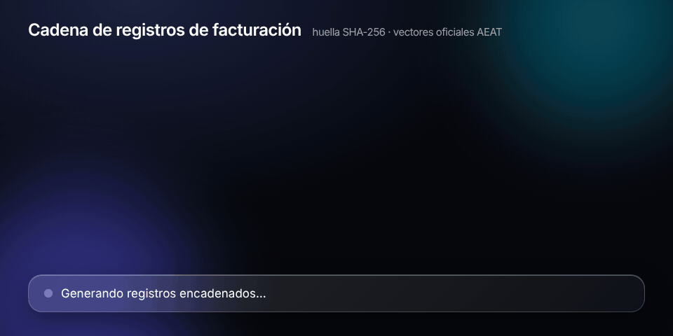
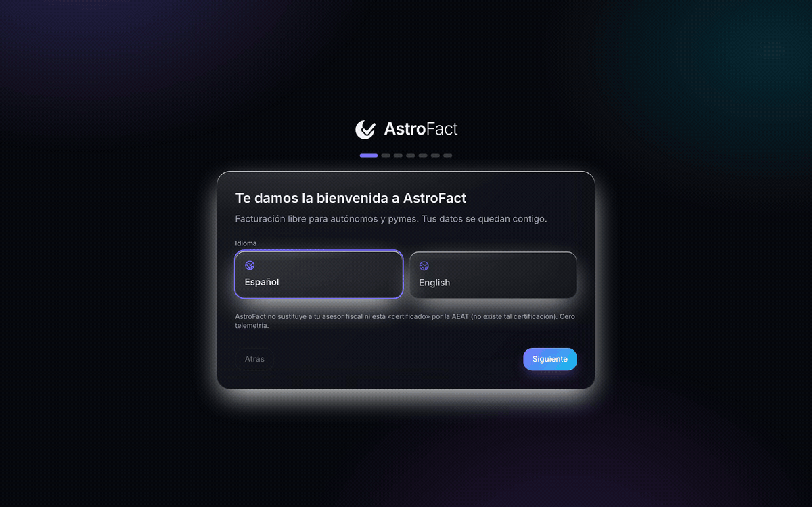
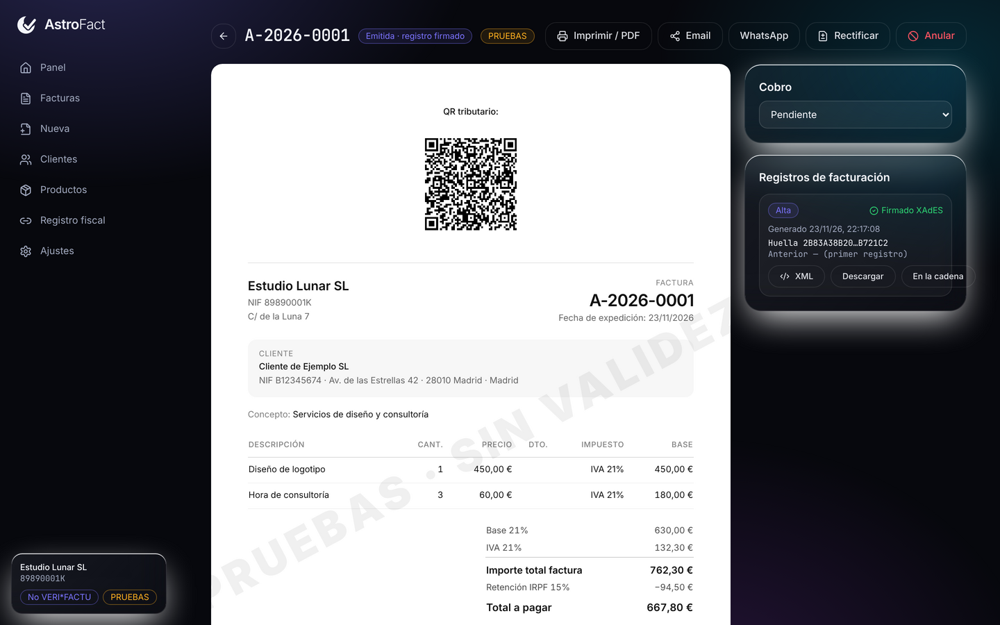
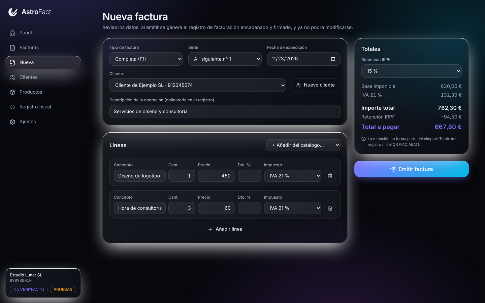
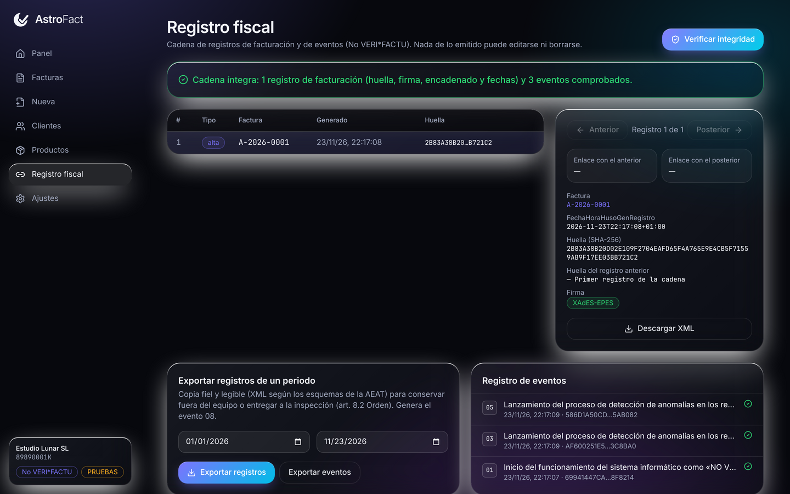
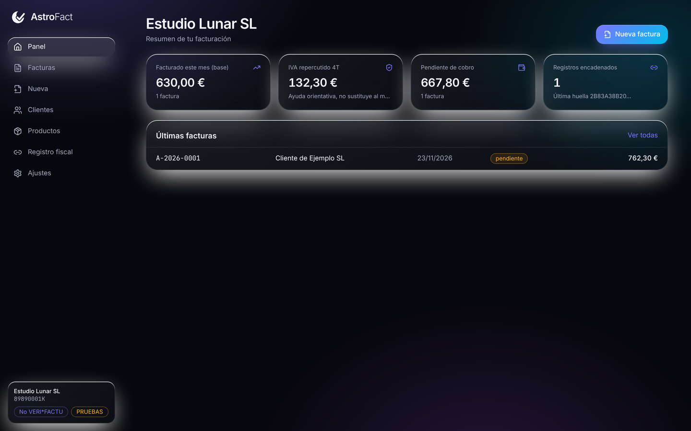
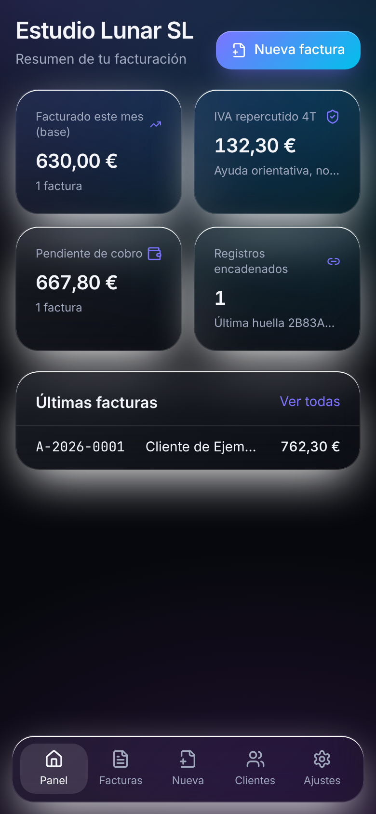
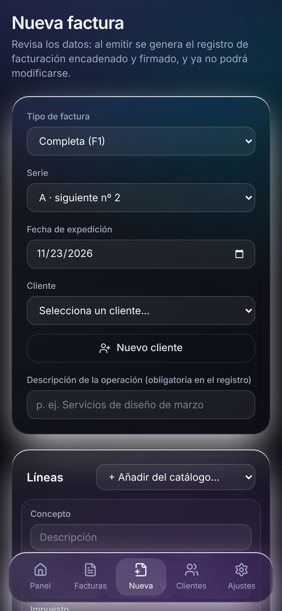

<p align="center">
  
</p>

<p align="center">
  <a href="https://github.com/AstroSoftwareMoon/AstroFact/actions/workflows/ci.yml"></a>
  
  
  
  
</p>

<h3 align="center">Facturación libre y gratuita para autónomos y pymes de España.<br>Tus datos, en tu dispositivo o en tu servidor. Sin cuentas, sin nubes ajenas.</h3>

---

AstroFact es un programa de facturación **de código abierto** pensado para cumplir el
[Reglamento de sistemas informáticos de facturación (RD 1007/2023)](https://www.boe.es/buscar/act.php?id=BOE-A-2023-24840)
y la [Orden HAC/1177/2024](https://www.boe.es/buscar/act.php?id=BOE-A-2024-22138), en sus dos modalidades:
**VERI\*FACTU** (envío automático de los registros a la AEAT) y **No VERI\*FACTU** (registros firmados y
conservados en tu equipo). Se construye **solo** a partir de la documentación oficial publicada por la AEAT
(ver [`docs/normativa`](docs/normativa/README.md)).

<p align="center">
  
  <br><sub>La cadena de registros usa los vectores oficiales de la AEAT. Si alguien toca un importe, AstroFact lo detecta al instante.</sub>
</p>

## 📸 Así se ve

<p align="center"></p>

<table>
<tr>
<td width="50%"><p align="center"><sub><b>Factura emitida</b> · QR tributario arriba, registro firmado con XAdES</sub></p></td>
<td width="50%"><p align="center"><sub><b>Nueva factura</b> · totales, IRPF y validaciones AEAT en vivo</sub></p></td>
</tr>
<tr>
<td><p align="center"><sub><b>Registro fiscal</b> · cadena navegable, verificación y eventos</sub></p></td>
<td><p align="center"><sub><b>Panel</b> · liquid glass, tema oscuro</sub></p></td>
</tr>
</table>

<p align="center">
  &nbsp;&nbsp;
  
  <br><sub>Mismo aspecto y mismas opciones en el móvil, con navegación inferior.</sub>
</p>

## ✨ Qué hace

| | |
|---|---|
| 🧾 **Facturas completas, simplificadas y rectificativas** | Por sustitución y por diferencias, varios tipos de IVA, recargo de equivalencia, retención IRPF, exentas, inversión del sujeto pasivo, IGIC e IPSI. |
| 🔗 **Registros encadenados con huella SHA-256** | Nunca se borra ni edita nada emitido. Botón para verificar la cadena y alarma si se rompe. |
| 📱 **QR tributario** | Generado según la especificación oficial (nivel M, 30–40 mm, «QR tributario:» y leyenda VERI\*FACTU). |
| ✍️ **Firma XAdES-EPES** | Firma de registros y eventos en modo No VERI\*FACTU con tu certificado (.p12 o almacén del sistema). |
| 📡 **Envío VERI\*FACTU** | SOAP a la AEAT con cola, reintentos y control de flujo (60 s / 1000 registros). |
| 🗂️ **Registro de eventos** | Inmutable y encadenado, con resumen cada 6 horas. |
| 🏠 **Tus datos son tuyos** | Modo local sin cuenta (SQLite cifrable) o servidor propio en Docker. Cero telemetría. |

## 🧭 Dos modos, la misma app

| | 💻 **Local** | 🐳 **Autohospedado** |
|---|---|---|
| Cuenta | No hace falta | Usuarios con roles y 2FA |
| Datos | En tu dispositivo (SQLite, cifrado opcional) | En tu servidor (SQLite o PostgreSQL) |
| No VERI\*FACTU | ✅ completo | ✅ |
| VERI\*FACTU | ✅ si hay internet y certificado | ✅ envío automático en segundo plano |
| Copias | `.astro` automáticas | Programadas en el servidor |

## ⬇️ Descargas

> Las primeras versiones instalables llegarán en la **fase 4**. Esta tabla se rellenará automáticamente con cada `tag v*`.

| Plataforma | Formato |
|---|---|
| Windows | `.msi` · `.exe` · portable |
| macOS | `.dmg` universal (Intel + Apple Silicon) |
| Linux | AppImage · `.deb` · `.rpm` |
| Android | `.apk` firmado · `.aab` |
| Servidor | Imagen Docker `amd64` / `arm64` |
| Web | PWA instalable |

## 🗺️ Estado del proyecto

- [x] **Fase 1 — `fiscal-core`**: registros de alta y anulación, huella, cadena, QR, firma XAdES, eventos, SOAP VERI\*FACTU, validaciones. **116 tests** con vectores oficiales y validación contra los XSD de la AEAT.
- [x] **Fase 2 — App local**: asistente de bienvenida, clientes (con RGPD), productos, emisión No VERI\*FACTU firmada con QR, anulaciones, rectificativas S/I, registro fiscal navegable, eventos, exportación por periodo, cifrado de datos. Base de datos con triggers de inmutabilidad. **E2E con Playwright.**
- [ ] Fase 3 — Diseño (liquid glass), PDF y plantillas
- [ ] Fase 4 — Empaquetado y releases multiplataforma
- [ ] Fase 5 — Servidor Docker y envío VERI\*FACTU contra el entorno de pruebas
- [ ] Fase 6 — Informes (303/130 como ayuda), gastos, recordatorios
- [ ] Fase 7 — Documentación de cumplimiento y pulido

## 🧑‍💻 Desarrollo

Requisitos: Node 22.13+, pnpm 10, `xmllint` (paquete `libxml2-utils`) para validar contra los XSD y, para la app de escritorio, Rust y las [dependencias de Tauri](https://v2.tauri.app/start/prerequisites/).

```bash
pnpm install
pnpm --filter @astrofact/client dev   # la app en http://localhost:5173 (navegador)
pnpm --filter @astrofact/client tauri dev  # la app de escritorio (Tauri 2)
pnpm --filter @astrofact/client e2e   # prueba E2E de emisión con Playwright
pnpm test            # todos los tests
pnpm -r build        # compila los paquetes
pnpm normativa:fetch # vuelve a descargar la normativa oficial y comprueba si ha cambiado
```

```ts
import { construirRegistroAlta, registroAltaXml, urlQr, toIsoWithOffset } from "@astrofact/fiscal-core";

const { registro, totales } = construirRegistroAlta({
  factura, sistema, anterior: null, fechaHoraGen: toIsoWithOffset(new Date()),
});
const qr = urlQr({ nif: registro.IDFactura.IDEmisorFactura, numSerie: registro.IDFactura.NumSerieFactura,
  fechaExpedicion: registro.IDFactura.FechaExpedicionFactura, importeTotal: registro.ImporteTotal },
  { entorno: "pruebas", verifactu: false });
```

## 📚 Documentación

- [Resumen de requisitos](docs/requisitos.md) · [Matriz de cumplimiento](docs/cumplimiento/matriz.md)
- [Arquitectura y esquema de base de datos](docs/arquitectura.md)
- [Normativa oficial utilizada (versiones y hashes)](docs/normativa/README.md) · [Puntos abiertos](docs/TODO-normativa.md)
- [Plantilla de declaración responsable](docs/cumplimiento/declaracion-responsable.md)

## ⚖️ Aviso legal

AstroFact **no está certificado ni homologado por la AEAT** (la normativa no prevé tal cosa: el productor
suscribe una *declaración responsable*). **No sustituye a tu asesor fiscal.** Las fechas de obligatoriedad son
configurables y pueden cambiar: compruébalas en el BOE. Antes de usarlo de verdad, prueba en el entorno de
pruebas de la AEAT. Más en [`docs/aviso-legal.md`](docs/aviso-legal.md).

<p align="center"><br><sub>Parte de la familia Astro · AGPL-3.0</sub></p>
